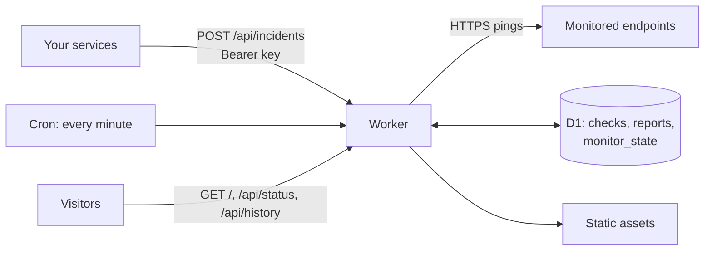

# Worker Status

A self-hosted status page that runs entirely on Cloudflare Workers, D1 and static assets. It combines scheduled HTTPS health checks with incident reports pushed by your own services, while keeping monitored URLs and credentials private.


## Table of contents

- [Features](#-features)
- [How it works](#-how-it-works)
- [Prerequisites](#-prerequisites)
- [Quick start](#-quick-start)
- [Deployment](#-deployment)
- [Configuration](#️-configuration)
- [Sending incidents](#-sending-incidents)
- [Public API](#-public-api)
- [Status, uptime and retention](#-status-uptime-and-retention)
- [Local development](#-local-development)
- [Testing](#-testing)
- [Project structure](#-project-structure)
- [Security notes](#-security-notes)
- [Troubleshooting](#️-troubleshooting)

## ✨ Features

- **Health checks**: HTTPS pings with private headers, run by a cron trigger every minute.
- **Incident ingestion**: authenticated `POST /api/incidents` endpoint for services to report issues by class.
- **Severity levels**: reported issues turn orange; elevated report counts or failed checks turn red.
- **Grouped services**: optional groups with labels and descriptions.
- **Custom branding**: title and colors configurable without rebuilding, with a light and dark theme.
- **Telegram notifications**: optional bot that notifies subscribers when incidents start and resolve.
- **Incident history**: paginated history of report episodes and ping outages.
- **Rolling retention**: data older than the configured window is removed automatically.
- **No frontend build**: vanilla HTML, CSS and JavaScript with no external browser dependencies.
- **One-command deploy**: creates or reuses D1, applies migrations, manages the API key and publishes.

## 🧭 How it works



The configuration (`STATUS_CONFIG`) and ingestion key (`INGEST_API_KEY`) are stored as Worker secrets. Only labels, derived statistics, report classes and incident times are exposed publicly.

## 📋 Prerequisites

- [Bun](https://bun.sh/)
- A Cloudflare account
- Wrangler authentication through `bun x wrangler login` or existing Cloudflare API credentials

## 🚀 Quick start

```sh
bun install
bun x wrangler login
cp config.json.example config.json
```

Edit `config.json` with your services (valid JSON, no comments), then deploy:

```sh
bun run deploy
```

The ingestion API key is saved to `deploy.secrets.json`. Use it in your service clients to [send incidents](#-sending-incidents).

## 📦 Deployment

```sh
bun run deploy            # validate, provision and publish
bun run deploy --dry-run  # validate config and bundle only
bun run deploy --help     # show usage
```

The deployment script runs these steps:

1. Validates `config.json` before making remote changes.
2. Creates `wrangler.jsonc` from `wrangler.jsonc.example` if it is absent, preserving an existing file.
3. Resolves the ingestion API key (see [API key handling](#api-key-handling)).
4. Reuses the configured D1 database ID, or finds/creates the `worker-status` database by name when the ID is still the placeholder, then saves the resolved ID locally. A non-placeholder ID that is missing from the account is treated as an error, never as permission to replace the database.
5. Applies remote D1 migrations.
6. Publishes the Worker, assets, cron trigger, `STATUS_CONFIG` and `INGEST_API_KEY` together using Wrangler `--secrets-file`.

Both secrets are sent on every deployment, so changes to `config.json` take effect when you redeploy.

### API key handling

The key is stored in the private file `deploy.secrets.json`:

```json
{ "INGEST_API_KEY": "your-api-key" }
```

- An existing key in `deploy.secrets.json` is always reused.
- A legacy `vars.INGEST_API_KEY` in `wrangler.jsonc` is migrated into that file.
- Otherwise, the script checks for an existing remote secret before generating a new 32-byte random key.
- Known keys are never rotated automatically. If a remote key exists but is not available locally, put that same key in `deploy.secrets.json` first.
- The key is never printed. Previously exposed keys are preserved for compatibility, not made safe by migration: rotate them deliberately and update all clients.

### Dry runs and failures

`--dry-run` validates the configuration and the real Worker bundle without creating remote resources or changing project configuration. It does not validate account access or apply migrations. A first dry run uses a disposable test key when none is configured.

The script stops on the first error. An already-created database or applied migration is not rolled back if a later stage fails; rerunning reuses the stored key and database and applies only pending migrations.

### Environment constraints

- Only the default Wrangler environment is supported; named environments are rejected.
- Invalid `CLOUDFLARE_ACCOUNT_ID` / `CF_ACCOUNT_ID` values are rejected with guidance instead of being silently ignored.
- Dependency installation never deploys or creates Cloudflare resources.

## ⚙️ Configuration

Start from `config.json.example`. Components without `ping` accept API reports only.

```json
{
  "branding": { "title": "Worker Status", "highlightColor": "#21876c" },
  "visualization": {
    "tickFrequency": "1day",
    "maxTimeSpan": "30day",
    "clearIssuesAfter": "30min",
    "elevatedAfter": 5
  },
  "groups": [
    { "name": "api", "label": "Global API", "description": "Public API services" }
  ],
  "components": [
    {
      "label": { "name": "service-uptime", "title": "Service uptime", "group": "api" },
      "ping": {
        "url": "https://example.com/health-check",
        "interval": "15min",
        "timeout": "10sec",
        "headers": { "Authorization": "replace-with-private-credential" }
      }
    },
    {
      "label": { "name": "user-management", "title": "User management", "group": "api" }
    }
  ]
}
```

**Durations** are positive integers followed by `sec`, `min`, `hour` or `day` (for example, `15min`).

### `visualization`

| Field | Required | Description |
|-------|----------|-------------|
| `tickFrequency` | Yes | Bucket width, at least `1min`. Buckets align to UTC Unix-epoch boundaries; labels use the viewer's local timezone. The first and last buckets may be partial. |
| `maxTimeSpan` | Yes | Rolling retention and display window, from `tickFrequency` up to `90day`. Produces at most 366 full buckets plus a partial boundary bucket. |
| `clearIssuesAfter` | Yes | Quiet period per component and class before an episode resolves. At least `1min`, no longer than `maxTimeSpan`. |
| `elevatedAfter` | No | Report count that marks severity as elevated (red). Integer, minimum `2`, default `5`. |

Active episodes count reports since the last quiet gap, while tick severity counts reports within that tick, so historical tick colors can differ from the current episode severity.

### `components`

Between 1 and 10 components are allowed.

| Field | Required | Description |
|-------|----------|-------------|
| `label.name` | Yes | Unique ID: 1–64 ASCII letters, digits, `-` or `_`, starting with a letter or digit. Case-insensitive and stored in lowercase. |
| `label.title` | Yes | Display title, up to 200 characters. |
| `label.description` | No | Display description, up to 200 characters. |
| `label.group` | No | Group name, up to 200 characters. Defaults to `Services`. If no matching entry exists in `groups`, the raw name is shown. |
| `ping.url` | With `ping` | HTTPS URL without embedded credentials. HTTP 2xx is success; redirects, other statuses, timeouts and network errors are failures. Redirects are not followed to avoid forwarding private headers. |
| `ping.interval` | With `ping` | At least `1min`, no longer than `maxTimeSpan`. Scheduling has minute-level granularity. |
| `ping.timeout` | No | Default `10sec`, maximum `20sec`. |
| `ping.headers` | No | Private request headers, never returned by the public API. |

Labels and descriptions are public.

### `groups`

Optional array of `{ "name", "label", "description" }`. Match `name` to each component's `label.group`; the UI shows the group label and description above its services. Names must be unique; names and labels accept up to 200 characters, descriptions up to 500. Groups without components are not rendered, and groups follow the order of first appearance in `components`. These fields are public.

### `branding`

| Field | Description |
|-------|-------------|
| `title` | 1–200 characters. Updates the browser tab, header and footer after the status API loads. |
| `backgroundColor`, `foregroundColor` | Base colors. Secondary surfaces and text derive from them. |
| `highlightColor` | Brand mark, link hover and focus outlines. |
| `successColor`, `warnColor`, `dangerColor` | Ticks, indicators and incident text. |

| `dark` | Optional object with the same color fields, applied in the dark theme. |

The page follows the system color scheme until the visitor uses the header toggle, which is remembered in the browser. Colors accept `#RGB` or `#RRGGBB`. The misspelled `succcessColor` is accepted as an alias; `successColor` takes precedence. Omitted fields keep the default styling, and removing `branding` restores defaults on refresh. Custom colors are applied as configured, so choose values with adequate contrast. The bundled favicon is not changed.

### `telegram`

Optional. Create a bot with [@BotFather](https://t.me/BotFather) and set `telegram.botToken`. The token is private and never returned by the public API.

- Once the cron has run, the header shows a **Notify me on Telegram** link to the bot.
- Users subscribe with `/start` and unsubscribe with `/stop`; the bot can also be added to groups.
- Each cron run reads bot updates and sends one message when an incident starts and one when it resolves. Chats that block the bot are removed.
- Commands are read with `getUpdates`, so do not configure a webhook for this bot or use the same token in another polling client.

### Limits

Each cron invocation pings at most 5 components concurrently, and the configuration allows up to 10 components to keep invocations bounded. Atomic D1 claims prevent duplicate pings from overlapping invocations. If an invocation crashes after claiming, the next attempt happens at the next interval; missing checks are not fabricated or backfilled. A ping becomes stale after its interval plus two minutes.

## 📣 Sending incidents

```sh
curl https://YOUR-WORKER.workers.dev/api/incidents \
  -X POST \
  -H "Authorization: Bearer $INGEST_API_KEY" \
  -H 'Content-Type: application/json' \
  --data '{"name":"service-uptime","class":"User Management API"}'
```

A successful request returns `202`:

```json
{ "accepted": true, "receivedAt": 1790000000000 }
```

`receivedAt` is a Unix timestamp in milliseconds.

| Field | Rules |
|-------|-------|
| `name` | An existing component name, case-insensitive (`Service-API` and `service-api` are the same component). |
| `class` | Trimmed, case-sensitive, 1–120 characters, no control characters. **Public text**: never include credentials, personal data or request contents. |

Each accepted POST counts as one report, and retries are not deduplicated. Send only real issue observations, not successful requests. Bodies are limited to 4096 bytes.

| Status | Cause |
|--------|-------|
| `400` | Invalid JSON or invalid `name`/`class` |
| `401` | Missing or incorrect API key |
| `404` | Unknown component |
| `405` | Method other than `POST` |
| `413` | Body larger than 4096 bytes |
| `415` | `Content-Type` is not `application/json` |
| `503` | Server key not configured |

Ingestion does not allow cross-origin browser requests. The key grants access to every configured component; configure Cloudflare rate limiting separately if needed.

## 🌐 Public API

| Endpoint | Description |
|----------|-------------|
| `GET /api/status` | Current status, ticks and statistics for every component, plus daily (UTC) p50/p95/p99 latency of successful health checks across all components. |
| `GET /api/history?offset=0` | Incident history in pages of 50. `offset` must be a non-negative integer up to 1,000,000. |

Responses are never cached. Only the page assets and these endpoints are served; any other path, including configuration files, returns `404`.

## 📊 Status, uptime and retention

**Colors**: orange means reported issues; red means elevated reports or failed health checks; gray means no observations. Tooltips show the three most reported classes in a tick, ordered by count and then by latest report. Health-check failures are shown separately.

**Report episodes** resolve automatically after `clearIssuesAfter`, independently per component and class. Reports at or after that deadline open a new episode.

**Ping incidents** resolve on the next successful check, not by expiration. A stale monitor remains visibly unverified.

**Ping uptime** is the percentage of successful observed checks, not a time-weighted SLA. API reports do not affect it.

**Report-only services** start as *Stable*, with green ticks and 100% incident-free time. Each report marks its tick and opens or extends an affected period until `clearIssuesAfter` after the latest report. The percentage is `(1 − affected time / maxTimeSpan) × 100`; overlapping classes count once, and ongoing periods are measured only up to now. The status returns to Stable once all reports expire, while historical ticks remain until retention removes them. This reflects the absence of reported incidents, not measured availability.

**Page refresh**: the page refreshes every minute while visible, unless a tooltip is open. A failed refresh marks the view as outdated.

**History** includes report episodes and ping outages. Pagination uses offsets, so new incidents or retention during browsing can shift pages; refreshing reloads the newest history.

**Retention**: the cron trigger deletes checks, reports and expired monitor state older than `maxTimeSpan`, and ingestion also performs cleanup. Public queries exclude expired data immediately; physical deletion depends on successful scheduled runs and normally happens within one minute. Long episodes are clipped to retained observations. Retention does not affect Cloudflare logs or D1 Time Travel backups, which follow platform policies.

**Costs**: report grouping is computed in indexed SQL over retained data instead of storing permanent incident rows. High report volume increases D1 reads and storage, so monitor your Cloudflare quotas.

## 💻 Local development

Copy `wrangler.jsonc.example` to `wrangler.jsonc` if it does not exist yet, then create a Git-ignored `.dev.vars` file at the repository root:

```dotenv
STATUS_CONFIG='{"visualization":{"tickFrequency":"1day","maxTimeSpan":"30day","clearIssuesAfter":"30min"},"components":[{"label":{"name":"service-uptime","title":"Service uptime","group":"api"}}]}'
INGEST_API_KEY='replace-with-your-api-key'
```

```sh
bun run db:local
bun run dev
```

Open `http://localhost:8787`. The local D1 database is isolated from production.

Local development does not run cron periodically. Trigger scheduled checks and cleanup manually:

```sh
curl 'http://localhost:8787/cdn-cgi/handler/scheduled'
```

Some Wrangler versions use `/cdn-cgi/local/scheduled` instead; check the startup output. Configuring real ping URLs makes manual cron runs contact those URLs.

### Scripts

| Command | Description |
|---------|-------------|
| `bun run dev` | Start Wrangler dev with scheduled-handler testing enabled. |
| `bun run deploy` | Validate, provision and publish (see [Deployment](#-deployment)). |
| `bun run db:local` | Apply D1 migrations locally. |
| `bun run db:remote` | Apply D1 migrations to the remote database. |
| `bun run test` | Run the offline test suite. |
| `bun run check` | Run tests and a Wrangler dry-run bundle. |

## 🧪 Testing

```sh
bun test
bun x wrangler deploy --dry-run
```

Offline tests use Bun SQLite with a lightweight D1 adapter. They cover configuration, API authentication, privacy, report thresholds, top-three ranking, quiet-gap recurrence, ping recovery, retention, history pagination and duplicate cron claims.

Deployment tests mock Wrangler to check step ordering, first setup, key preservation, failure handling and temporary secret cleanup, without Cloudflare costs. They do not replace testing on the real Cloudflare runtime. The dry run bundles the Worker without publishing it.

## 📁 Project structure

```text
├── migrations/            D1 schema (checks, reports, monitor_state, telegram_*)
├── public/                Static status page (HTML, CSS, JS, favicon)
├── scripts/deploy.js      Deployment script
├── src/
│   ├── worker.js          HTTP routes and cron handler
│   ├── config.js          Configuration parsing and validation
│   ├── status.js          Status aggregation, history and retention
│   └── telegram.js        Telegram subscriptions and notifications
├── tests/                 Offline worker and deployment tests
├── config.json.example    Sample status configuration
└── wrangler.jsonc.example Sample Wrangler configuration
```

## 🔒 Security notes

- `config.json`, `wrangler.jsonc` and `deploy.secrets.json` are Git-ignored and never served as assets. Commit only the sanitized `.example` files.
- Temporary secret files are created outside the repository and removed after Wrangler finishes, including on errors. A forced process termination can skip this cleanup.
- Do not enable verbose Wrangler logging while deploying, because it can expose secrets.
- Ping URLs and headers stay private; component labels, descriptions, groups, branding and report classes are public.

## 🛠️ Troubleshooting

| Symptom | Cause and fix |
|---------|---------------|
| Deploy fails with a config error | The message names the invalid field, such as `components[0].ping.url`. Fix it in `config.json` and rerun. |
| Deploy stops partway | Rerun `bun run deploy`. The database and key are reused and only pending migrations are applied. |
| Remote key exists but deploy refuses to continue | Put the existing key in `deploy.secrets.json`. The script never rotates a known key automatically. |
| API returns `503` | `INGEST_API_KEY` is not set, or migrations were not applied. Redeploy or run `bun run db:remote`. |
| Health checks never appear locally | Cron does not run automatically in dev. Call `/cdn-cgi/handler/scheduled`. |
| A healthy endpoint is reported as failing | Redirects count as failures. Point `ping.url` to the final HTTPS URL that returns 2xx. |
